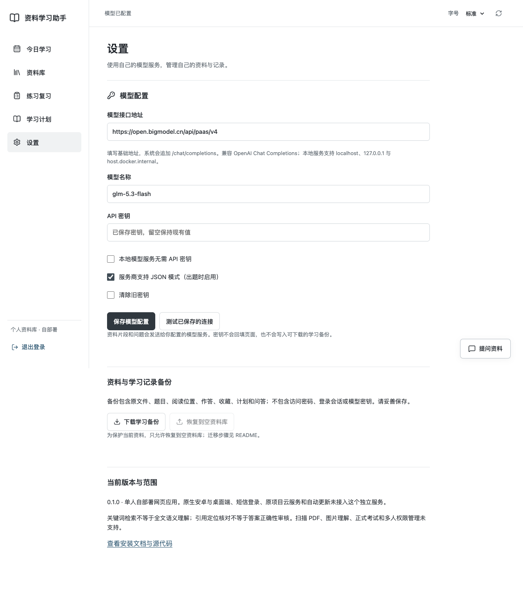
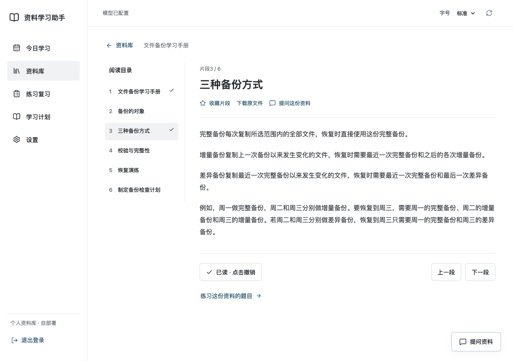
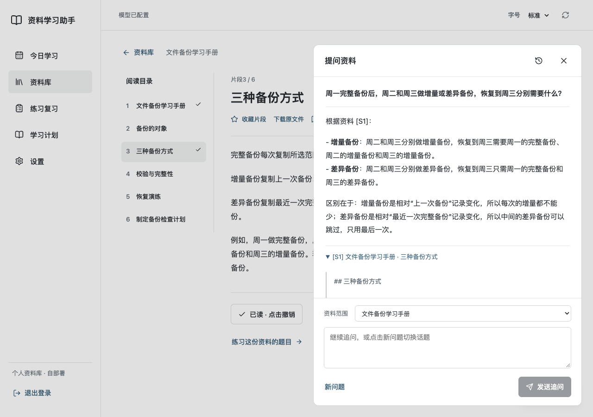
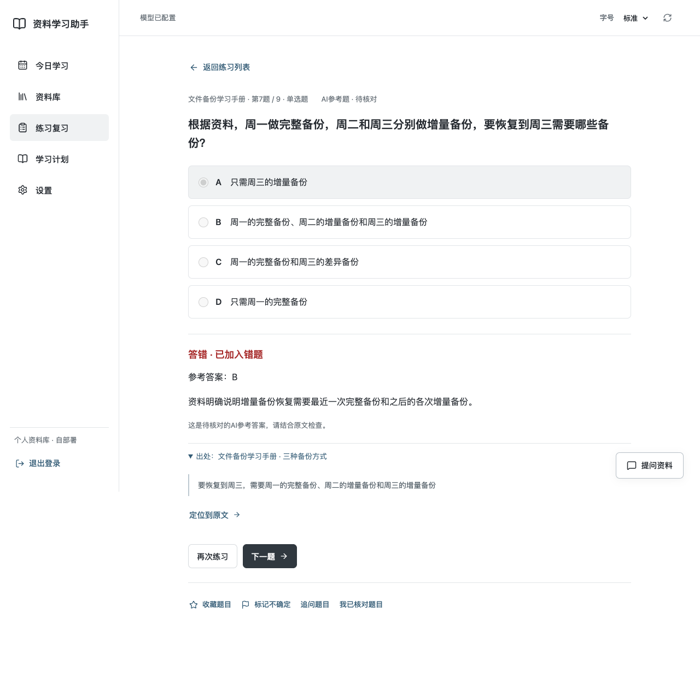
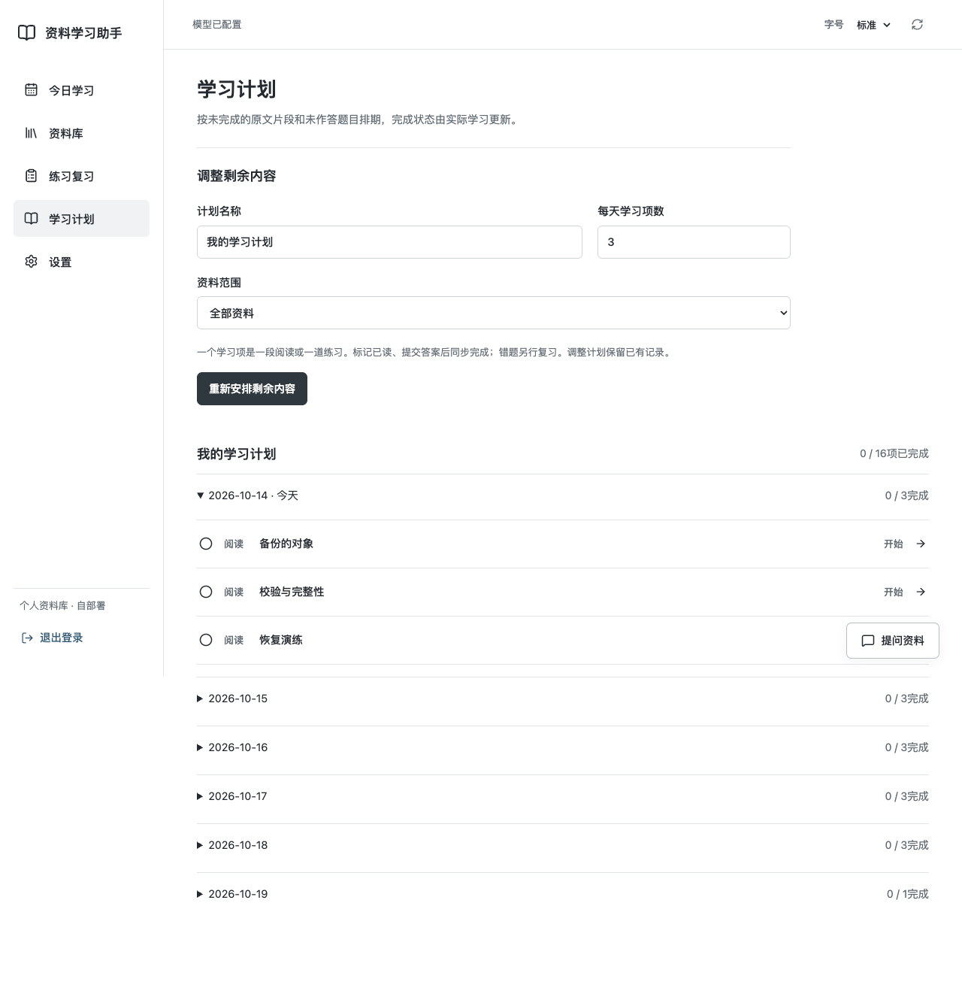

# 资料学习助手

导入自己的资料，连接自己的模型，完成**阅读 → 带出处问答 → 练习 → 错题复习 → 学习计划**。这是基于 [kouqiang-beikao](https://github.com/19991621059/kouqiang-beikao) 学习流程和部分代码制作的独立开源项目，原项目继续保留。

当前是 **0.1.0 单人自部署网页应用**，使用 React、FastAPI 和 SQLite。不需要原项目的 uniCloud、短信账号或私有教材。源码和项目原创示例采用 [MIT 许可证](LICENSE)。


演示来自实际浏览器录屏，展示自配模型连接、原文阅读、真实模型问答与出处、真实生成参考题、作答和学习计划。没有使用设计稿或伪造回复；仅使用本项目原创备份知识示例。截图和录屏方法见 [验证记录](TASKS.md)。

## 可以做什么

| 功能 | 当前行为 |
| --- | --- |
| 资料导入 | UTF-8 TXT、Markdown、文字 PDF、DOCX、指定格式的 JSON 资料包；保留原文件，可下载 |
| 阅读与检索 | 分段目录、阅读位置、已读与收藏；中文关键词检索；PDF保留物理页码 |
| 自配模型 | 填写接口基础地址、模型名称、API 密钥；支持 OpenAI Chat Completions 协议和兼容的本地服务 |
| 带出处问答 | 流式回复、历史与追问；展开原文片段并跳转，缺少依据时提示证据不足 |
| 练习与复习 | 单选、多选、草稿保存、参考判分、解析出处、错题、收藏、不确定、随机与连续练习 |
| 生成练习 | 根据一份资料生成1–10道题，校验格式与逐字出处，保持“AI生成 · 待核对”标识 |
| 学习计划 | 按剩余阅读片段和未作答题目、每天学习项数排期；真实操作更新完成状态 |
| 记录与迁移 | SQLite持久化、服务重启恢复、学习备份导出并恢复到空资料库 |

原项目的阅读、练习、错题、收藏、不确定和计划流程在这里有独立实现。原生安卓/桌面客户端、短信登录、云端跨设备账号和自动更新仍保留在原项目，**本仓库没有接入或发布这些客户端与云服务**。

## 本机安装：先用这一种

准备 [Python](https://www.python.org/downloads/) **3.11或更新版本**、[Node.js](https://nodejs.org/en/download) **22.13或更新版本**、Git，以及浏览器。安装过程需要联网下载依赖；模型调用另需可用服务和你自己的密钥。输入密钥时浏览器暂存表单内容，保存成功后清空；以后由后端读取已存密钥调用模型，不回填页面。

### macOS / Linux

打开终端，逐行执行：

```sh
git clone https://github.com/19991621059/knowledge-study-assistant.git
cd knowledge-study-assistant
sh scripts/setup.sh
sh scripts/start.sh
```

安装脚本会安装锁定的依赖、构建页面，并在首次安装时要求输入两遍访问密码。密码至少12个字符，输入时不显示。已有密码和学习记录会保留。

看到服务启动后，打开 **<http://127.0.0.1:8000>**，输入刚才设置的访问密码。停止服务按 `Ctrl+C`；下次进入项目目录执行 `sh scripts/start.sh` 即可，不必重新安装。

### Windows PowerShell

先安装上述软件，重开 PowerShell，再逐行执行：

```powershell
git clone https://github.com/19991621059/knowledge-study-assistant.git
cd knowledge-study-assistant
py -3 -m venv .venv
.\.venv\Scripts\python.exe -m pip install -r backend/requirements.lock
.\.venv\Scripts\python.exe -m pip install --no-deps -e backend
npm.cmd ci
npm.cmd run build
.\.venv\Scripts\python.exe -m study_assistant init
.\.venv\Scripts\python.exe -m study_assistant serve
```

打开同一个本机地址。再次启动只需要最后一行。这里直接使用虚拟环境中的Python，不需要修改 PowerShell 执行策略。Windows步骤按可用路径编写，**本轮没有在Windows主机运行验收**。

### 不使用安装脚本

macOS/Linux也可以手动执行与脚本一致的步骤：

```sh
python3 -m venv .venv
.venv/bin/python -m pip install -r backend/requirements.lock
.venv/bin/python -m pip install --no-deps -e backend
npm ci
npm run build
.venv/bin/python -m study_assistant init
.venv/bin/python -m study_assistant serve
```

## 第一次使用：完整走一遍

1. **导入资料。**打开“资料库”→“导入示例”，获得原创《文件备份学习手册》和3道示例题。也可以“导入资料”选择自己的文件。同一个文件重复导入不会重复生成资料和学习身份。
2. **连接模型。**打开“设置”，填写下面的三个字段，点击“保存模型配置”，再点“测试已保存的连接”。不配置模型也能阅读、练习导入题、收藏和安排计划。
3. **阅读。**进入示例，打开“三种备份方式”。阅读后点击“标记已读”；单纯打开页面不表示掌握。目录、字号、上一段/下一段与原文件下载均可使用，再从资料库打开会恢复上次阅读片段和位置。原文读取失败可在页面重试。
4. **提问并核对。**点“提问这份资料”，输入“增量备份和差异备份有什么区别？”。回复完成后展开 `[S1]`，检查原文，再点“定位到原文”。关闭问答后可继续阅读；已完成问答保存在历史中。
5. **生成与作答。**打开“练习复习”→“生成练习题”，选择资料、题数和主题。打开一题，选择选项并提交，查看解析及原文。AI题默认待核对，确认答案和解析后才点“我已核对题目”。
6. **复习错题。**切到“错题”，再次练习。最新一次答对后移出当前错题，历史作答保留。收藏、不确定可分别筛选，连续练习保留筛选范围。“查看答案”不会计为完成作答。
7. **创建计划。**打开“学习计划”，填写每天学习项数，例如3。一个学习项是一段阅读或一道题；计划根据未完成内容排期。回“今日学习”完成任务，再观察统计变化。
8. **保留和迁移。**重启服务后重新登录，阅读位置、作答、收藏、计划和已完成问答仍在。定期到“设置”下载学习备份，迁移方法见下文。

### 模型怎么填

| 字段 | 填写方式 |
| --- | --- |
| 模型接口地址 | 服务商提供的基础地址，一般以 `/v1` 结尾；系统追加 `/chat/completions`，无需填完整请求路径 |
| 模型名称 | 服务商提供的精确模型标识，不是网页上的展示名称 |
| API 密钥 | 你自己的服务端调用密钥；保存后输入框清空，留空再次保存会保留现有值 |

本轮实际使用的配置为：地址 `https://open.bigmodel.cn/api/paas/v4`，模型 `glm-5.3-flash`，启用服务商支持的 JSON 模式。真实连接、流式问答和生成3道题都经过验证。**这只证明该配置在验证时可用，其他服务商需要自行测试**；没有内置公共密钥。

本机 [Ollama 的兼容接口](https://docs.ollama.com/api/openai-compatibility) 可填写 `http://127.0.0.1:11434/v1`，模型名称使用你已安装的模型，并勾选“本地模型服务无需 API 密钥”。Docker中访问宿主机模型改用 `http://host.docker.internal:11434/v1`。本轮没有实际运行Ollama；模型须支持流式文本和有效的JSON出题，是否启用JSON模式按其服务能力决定。

更换接口地址时必须重新输入密钥，或明确清除旧密钥，避免将旧密钥发送到新的地址。服务商不支持 `response_format` 时，取消“服务商支持JSON模式”再保存。当前未适配 Responses API、Anthropic 原生接口、工具调用或图片输入。



### 示例与自己的题库

[examples/backup-study.json](examples/backup-study.json) 包含5段原创正文和3道手写题，正文分为6个阅读片段。[Markdown版本](examples/backup-study.md) 是同一正文，适合体验上传和AI出题；两种文件内容的字节不同，分别导入会形成两份资料。

普通 TXT/MD/PDF/DOCX 只导入正文，不自动把其中的试题转换为题库。导入现有题库请按 [示例格式](examples/README.md) 制作 `study-bundle-v1` JSON，答案索引从0开始，出处必须逐字存在于相应原文。任一题格式或出处错误时整份导入失败，不保存半份题库。






## 部署到自己的服务器

仓库公开不等于在线服务已部署。可以在自己的服务器按本机步骤安装，再通过HTTPS反向代理访问；也提供Docker配置。**本轮没有Docker运行环境，也没有部署到公网，下面是部署说明，不是已上线证明。**

### Docker Compose

需要 Docker Engine/Desktop 和 Compose v2。在仓库根目录：

```sh
cp .env.example .env
```

用编辑器打开 `.env`，把 `STUDY_PASSWORD` 改为你自己的至少12字符密码，再执行：

```sh
docker compose up -d --build
docker compose logs -f study
```

打开 <http://127.0.0.1:8000>。容器使用非root用户，学习记录和加密密钥存放在 `study-data` 命名卷；重建容器不会清空该卷。不要使用 `docker compose down -v` 清除学习记录。

`STUDY_PASSWORD` 只在空数据目录首次启动时初始化密码。已有密码不会被修改 `.env` 覆盖，忘记密码的处理见下文。

### HTTPS 反向代理

域名和证书由你自己的反向代理配置。以下以 `study.example.com` 为占位示例，替换成你的真实域名：

```caddyfile
study.example.com {
    reverse_proxy 127.0.0.1:8000 {
        flush_interval -1
    }
}
```

容器的 `.env` 同时设置：

```dotenv
STUDY_ORIGIN=https://study.example.com
STUDY_SECURE_COOKIE=1
```

重新创建服务使设置生效：

```sh
docker compose up -d
```

非Docker部署时，在启动进程的环境中设置这两个变量。代理需要传递原始Host并允许长连接/流式回复。应用默认只监听本机地址；公开部署请保留访问密码与HTTPS，不要让多人把同一份资料库当成有用户隔离的服务。远程HTTP也可能使浏览器的安全上下文功能不可用。

| 环境变量 | 默认 / 作用 |
| --- | --- |
| `STUDY_DATA_DIR` | 项目根目录 `data/`；可指定绝对路径以隔离实例 |
| `STUDY_PASSWORD` | 可选，仅首次空库初始化；交互安装不需要设置 |
| `STUDY_ORIGIN` | 默认接受实际同源请求；代理部署设置完整HTTPS来源，不带末尾斜杠 |
| `STUDY_SECURE_COOKIE` | HTTPS部署设置为1；本机HTTP保持0 |
| `STUDY_TIMEZONE` | `Asia/Shanghai`；决定计划日期与今日统计 |
| `STUDY_DEV_ORIGIN` | 开发时额外允许的前端来源，如 `http://127.0.0.1:5173` |

`.env` 由Docker Compose读取，本机启动脚本不会自动加载它；本机可用操作系统的环境变量设置方式。原文件、问题和命中的资料片段会发送给你配置的模型服务，请按自己的资料用途选择服务。

## 备份、迁移与忘记密码

“设置”→“下载学习备份”生成 `study-backup-v1` JSON，含原文件、题目、阅读位置、作答、收藏、计划和问答。**不含访问密码、会话、模型配置或API密钥**；备份本身含你的资料，应私下保管。

迁移到另一台机器：安装应用并设访问密码 → 在空资料库的“设置”恢复备份 → 重新配置模型。恢复有引用关系校验，失败不会保留半份记录；已有资料库会拒绝覆盖。本轮已在另一个独立空服务中验证恢复。

同机测试恢复可使用新的数据目录和端口，原目录继续保留：

```sh
STUDY_DATA_DIR="$PWD/data-restored" .venv/bin/python -m study_assistant init
STUDY_DATA_DIR="$PWD/data-restored" .venv/bin/python -m study_assistant serve --port 8001
```

打开 <http://127.0.0.1:8001> 恢复学习备份。Windows在两个命令前设置 `$env:STUDY_DATA_DIR = "$PWD\data-restored"`，使用 `.venv\Scripts\python.exe`。

如果需要连同模型密钥一起迁移，先停止服务，再私下备份**整个数据目录**或Docker数据卷，包括 `study.sqlite3` 和 `secret.key`。仅复制数据库会使已存密钥无法解密。不要将这些文件上传到GitHub。

忘记访问密码：停止服务后运行 `.venv/bin/python -m study_assistant init`，重新设置，再启动。Windows使用 `.\.venv\Scripts\python.exe -m study_assistant init`；Docker使用 `docker compose exec study python -m study_assistant init`。学习记录保留，旧登录会话失效。

## 功能限制与常见问题

- **单人资料库。**只有一个访问密码、一个模型配置、一份学习记录；没有独立用户、团队权限、原项目云账号同步或商业运营配套。
- **文件与读取。**单文件20MB、200万字符、PDF最多500页、最多4000片段；扫描/加密PDF和含无法提取文字页面的PDF会拒绝，需先解除密码、OCR或分卷。图片、公式图、脚注、复杂版式和DOCX分页不保留；DOCX表格按文字读取。PDF页号是物理页码，其他格式按段和标题定位。
- **检索与问答。**使用关键词/BM25，不是向量语义检索；一次问答只使用少量匹配片段，不保证覆盖整本书。出处检查验证文段身份和版本，不自动证明回答结论正确。资料外问题、同义改写或资料冲突可能答不出或需要你核对。
- **生成题。**只有客观单选/多选题，没有正式模考、简答评分或官方真题认证。检查格式、答案范围和逐字出处，不自动核验专业正确性；重复检查只识别题干与选项相同的题，近义重复仍可能出现。整批不符合要求时不保存，可改主题或换模型重试。
- **学习计划。**按学习项数确定性排期，不由AI评估掌握程度，不编造学习时长。答错也是一次实际作答，复习在错题区完成；新导入内容或新生成题需要重新安排计划。
- **中断与保存。**已完成问答保存到历史；停止、断网或没有完整有效引用的回复不保存为成功回答。不要刷新仍在生成的请求；可能已消耗服务商额度。同一完成请求编号重放不会重复保存，浏览器刷新后新发的请求属于新操作。
- **环境与验证。**真实验收使用macOS的Chrome，包括1280宽屏、390窄屏、130%字号、返回和键盘焦点。没有验收Windows、真实手机软键盘/屏幕阅读器、Docker运行、公网HTTPS、所有模型厂商或高并发大库。

| 问题 | 处理方式 |
| --- | --- |
| 页面显示未初始化 | 在同一个数据目录执行 `python -m study_assistant init`，再启动 |
| 页面缺失或显示构建提示 | 在仓库根目录执行 `npm ci`、`npm run build` 后重启 |
| 8000端口占用 | `python -m study_assistant serve --port 8001`，浏览器使用相同端口 |
| 模型401/403、模型不存在 | 核对服务商地址、精确模型标识、密钥和可用额度；保存后再测试 |
| 出题失败或引用无效 | 取消不支持的JSON模式、减少题数或调整主题；失败整批未保存 |
| 检索不到文字 | 用原文中的两个以上字符关键词；检查文件是否含可提取文字 |
| 代理后保存403 | 核对 `STUDY_ORIGIN` 与浏览器地址完全一致，包括协议和端口 |
| 重启后看不到记录 | 核对启动进程的 `STUDY_DATA_DIR`，不要误用另一套空目录 |

## 开发与验证

安装后执行：

```sh
.venv/bin/python -m ruff check --config backend/pyproject.toml backend/study_assistant tests scripts
.venv/bin/python -m pytest -c backend/pyproject.toml tests -q
npm run build
npx playwright install chromium
STUDY_BROWSER_CHANNEL=chromium npm run test:e2e
```

浏览器自动化使用独立测试数据和**可控模型夹具**，不会调用你的真实模型；测试密码只用于该测试服务。实际模型验收、媒体复录和重启核对脚本见 [TASKS.md](TASKS.md)。本轮已通过20项后端检查、2条浏览器流程，另完成真实 `glm-5.3-flash` 调用及重启/空库恢复；每项验证的范围独立记录。

开发前端：另开终端执行 `npm run dev`；后端进程额外设置 `STUDY_DEV_ORIGIN=http://127.0.0.1:5173`。页面代理API到8000端口，生产环境使用构建后的同源页面。结构和接口所有权见 [架构说明](docs/architecture.md)。

## 开源内容与贡献

本仓库没有公开原项目教材、原题库、PDF、图片、壁纸、宠物素材、运行数据库、密钥和私人记录。分发内容只有原创示例及示例产生的真实演示。导入私人资料不会自动获得公开分发权；新增资料需附授权说明，AI题必须标明来源与待核对状态。

代码来源与第三方许可见 [THIRD_PARTY_NOTICES.md](THIRD_PARTY_NOTICES.md) 和 [来源清单](docs/upstream-provenance.json)。欢迎提交可复现的问题和PR；请只使用有授权的最小示例，移除密钥与私人资料，并说明预期行为、实际行为和验证范围。
