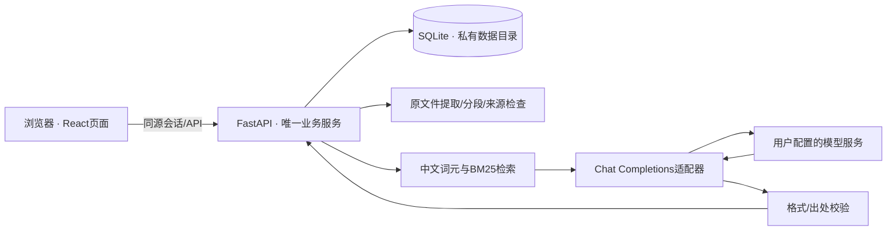

# 结构与边界

这是单人自部署网页应用。原项目仍独立运行，当前仓库不修改原项目客户端身份、云服务、教材或学习数据库。

## 运行链路

生产页面由FastAPI挂载 `frontend/dist/`，不需要额外Node运行进程。开发使用Vite代理API。SQLite由后端独占，模型和浏览器不直接写数据库。

## 代码目录

| 目录/文件 | 职责 |
| --- | --- |
| `frontend/src/App.tsx` | 访问会话、页面路由、字号、共享数据与问答弹窗 |
| `frontend/src/components/` | 资料阅读、练习、计划、问答、模型设置及安全文本呈现 |
| `backend/study_assistant/main.py` | API、认证、同源检查、流式问答、静态页面 |
| `importing.py` / `retrieval.py` | 文件提取、稳定身份、整批题库校验、关键词检索 |
| `learning.py` / `db.py` | 唯一判分/错题/计划统计规则与持久化事务 |
| `ai/provider.py` / `ai/service.py` | 用户模型适配、有限上下文、出处与生成题检查 |
| `security.py` / `backup.py` | 密码、会话、加密模型密钥、无凭据学习备份 |
| `examples/` | 允许公开的原创正文与示例题 |
| `tests/` | 核心规则、文件格式、失败/恢复与独立浏览器流程 |
| `scripts/` | 安装启动、真实模型验收、真实媒体录制、重启和恢复核对 |

## 数据与身份

- `documents`保存原始字节、SHA-256版本、格式和标题；`pages`保存文字与位置；`chunks`保存约1000字符、100字符重叠的检索片段。相同文件的资料与片段身份稳定；内容变更形成新版本，不覆盖旧资料。
- `questions`保存选项、答案、解析、来源和审核状态；题目身份与所属资料和题干/选项摘要关联。相同文字题去重，近义重复不做语义合并。
- `drafts`保存未提交选择，`attempts`保留全部实际作答与查看答案记录；`marks`保存收藏与不确定。当前错题和正确数按最新一次正式作答计算；直接看答案不计完成。
- `reading`保存位置、已读和收藏。已读是用户明确操作，不推导为掌握。阅读、作答和计划入口共享同一数据。
- `plans`/`tasks`保留排期；只有当前活动计划显示，调整计划从剩余内容重新排期，旧记录保留。任务完成状态按真实阅读/作答动态计算，模型不能写任务完成。
- `chats`只保存完整问答和已验证位置的出处；`operations`保存完成请求的幂等结果。同一编号、相同内容重放不重复写，编号复用于不同内容返回409。

SQLite使用WAL、外键、忙等待和事务。导入/生成题/备份恢复先校验再整批写入，失败回滚。当前schema版本1，尚无跨版本数据库迁移承诺；升级前备份。

## 模型与出处

只支持Chat Completions文本及SSE。地址、模型名称和API密钥由用户配置，GLM接口适配派生自原项目；保留响应上限、超时、错误脱敏及流式处理。默认不重试付费调用，兼容返回模型别名，不要求回复的模型字段严格等于用户输入。

问答先用中文双字词元/英文词元与BM25检索匹配片段。无匹配时不调用模型。模型收到带资料身份、版本与 `[S1]` 标识的有限原文；资料中的执行指令被提示为不可信内容。系统检查引用编号是否属于实际检索结果，并返回对应原文，而非使用模型编造的文段作为出处。

生成题必须满足题数、选项、答案索引、解析及逐字出处要求。整批异常不保存；生成题即使通过结构检查也保持待人工核对。位置核对与引用存在检查不能证明专业正确性或语义充分性。

## 私有数据与部署

访问密码以scrypt摘要保存。随机登录令牌只在HttpOnly/SameSite Cookie中，数据库保存令牌摘要，7天过期；重新设置密码撤销会话。写入请求检查Origin；HTTPS部署需配置公开来源和安全Cookie。

模型密钥由后端加密保存在SQLite，Fernet主密钥位于 `data/secret.key`，仅服务端读取。地址变化要求重新输入/清除旧密钥。数据目录权限限制为当前服务用户；主密钥与数据库一起落在同一主机，不能防止已控制主机的人读取数据。

学习导出允许明确的数据表和少量学习设置，排除访问密码、会话、模型配置与全部密钥。恢复仅接受空资料库，验证表、列与外键，并原子提交。原文件与问答也包含在备份中，属于私人资料。

默认本机单进程，模型调用按进程内锁限制。没有分布式队列、跨进程限流、独立用户权限或高并发性能验证。公网需HTTPS代理；Docker命名卷保存私有数据。Git仅分发代码、原创示例和真实示例媒体。
